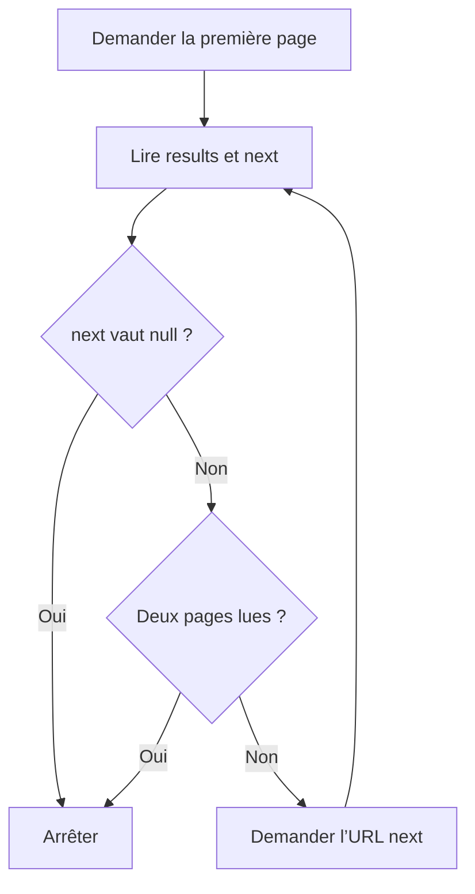

import { Aside, Steps, Tabs, TabItem } from '@astrojs/starlight/components';

Les endpoints de liste renvoient une page de ressources plutôt que toutes les données. Utilisez `limit` pour choisir la taille de la page et `offset` pour sauter des ressources.

## Lire une page

<Steps>

1. Commencez avec `pokemon/?limit=5&offset=0` pour demander les cinq premiers Pokémon.
2. Lisez les champs de la réponse ci-dessous. Utilisez l’URL de `next` pour demander la page suivante ; dans cet exemple, son décalage est `5`.
3. Arrêtez-vous lorsque `next` vaut `null`. Les exemples ci-dessous s’arrêtent volontairement après deux pages au maximum.

</Steps>

| Champ | Signification |
| --- | --- |
| `count` | Nombre total de ressources correspondantes, pas la taille de la page actuelle. |
| `results` | Ressources de cette page, chacune avec un nom et une URL. |
| `next` | URL de la page suivante, ou `null` à la fin. |
| `previous` | URL de la page précédente, ou `null` au début. |

<Aside type="tip" title="Suivez le lien next">

Suivre l’URL `next` évite de reconstruire les paramètres de pagination vous-même. L’exemple cURL écrit les deux URL explicitement pour exécuter les requêtes séparément.

</Aside>

## Visualiser la pagination

Ce schéma suit la même limite de deux pages que les exemples ci-dessous. Les étapes numérotées ci-dessus décrivent également le parcours en texte.



## Essayer deux pages

Choisissez un langage. Tous les exemples affichent les réponses JSON de deux pages de cinq ressources au maximum.

- **cURL :** collez les commandes dans votre terminal.
- **Python :** enregistrez le code dans `pagination.py`, puis lancez `python3 pagination.py` ; seule la bibliothèque standard est nécessaire.
- **PHP :** enregistrez-le dans `pagination.php`, puis lancez `php pagination.php` ; nécessite PHP 8 ou une version ultérieure avec l’extension cURL.

<Tabs>

<TabItem label="cURL">

```sh
curl --fail --show-error --silent --max-time 15 \
  'https://pokeapi.co/api/v2/pokemon/?limit=5&offset=0'

curl --fail --show-error --silent --max-time 15 \
  'https://pokeapi.co/api/v2/pokemon/?limit=5&offset=5'
```

</TabItem>

<TabItem label="Python">

```python
import json
from urllib.request import Request, urlopen

url = "https://pokeapi.co/api/v2/pokemon/?limit=5&offset=0"
for _ in range(2):
    request = Request(url, headers={"User-Agent": "pokedocs-astro/0.0 (documentation example)"})
    with urlopen(request, timeout=15) as response:
        page = json.load(response)
    print(json.dumps(page, indent=2))
    url = page["next"]
    if url is None:
        break
```

</TabItem>

<TabItem label="PHP">

```php
<?php

$url = 'https://pokeapi.co/api/v2/pokemon/?limit=5&offset=0';
for ($pageIndex = 0; $pageIndex < 2 && $url !== null; $pageIndex++) {
    $request = curl_init($url);
    curl_setopt_array($request, [
        CURLOPT_RETURNTRANSFER => true,
        CURLOPT_FAILONERROR => true,
        CURLOPT_TIMEOUT => 15,
    ]);
    $response = curl_exec($request);
    if ($response === false) {
        $error = curl_error($request);
        curl_close($request);
        throw new RuntimeException($error);
    }
    curl_close($request);

    $page = json_decode($response, true, 512, JSON_THROW_ON_ERROR);
    echo json_encode($page, JSON_PRETTY_PRINT | JSON_THROW_ON_ERROR), PHP_EOL;
    $url = $page['next'];
}
```

</TabItem>

</Tabs>

La première page commence par `bulbasaur` ; la seconde par `charizard`. Chaque URL de ressource mène à un endpoint de détail, comme `https://pokeapi.co/api/v2/pokemon/1/`.

<Aside type="caution" title="Limitez le nombre de requêtes">

Ces exemples s’arrêtent après deux pages pour éviter de télécharger tout le catalogue. Mettez les réponses en cache dans votre application et respectez la [politique d’utilisation de PokéAPI](https://pokeapi.co/docs/v2#fairuse) (en anglais).

</Aside>

## HTTP ou Pokébase ?

Ces exemples utilisent HTTP directement pour conserver le comportement exact de `limit` et `offset`. L’interface de liste de Pokébase récupère toutes les ressources et n’expose pas une pagination équivalente. Utilisez-la pour les exemples de détail décrits dans [Utiliser Pokébase avec Python](/fr/guides/python-sdk/).

Consultez la référence générée [List Pokémon](/api/operations/pokemon_list/) (en anglais) pour les paramètres et le schéma de réponse, ou commencez par [votre première requête](/fr/guides/first-request/).
