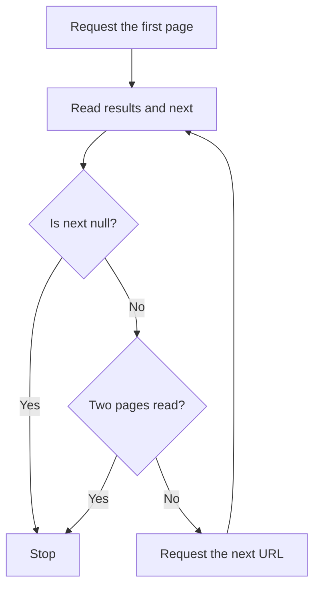

import { Aside, Steps, Tabs, TabItem } from '@astrojs/starlight/components';

List endpoints return a page of resources instead of the full dataset. Use `limit` to choose the page size and `offset` to skip resources.

## Read a page

<Steps>

1. Start with `pokemon/?limit=5&offset=0` to request the first five Pokémon.
2. Read the response fields below. Use the URL in `next` to request the following page; in this example, its offset is `5`.
3. Stop when `next` is `null`. The examples below deliberately stop after at most two pages.

</Steps>

| Field | Meaning |
| --- | --- |
| `count` | Total number of matching resources, not the current page size. |
| `results` | Resources returned on this page, each with a name and URL. |
| `next` | URL of the following page, or `null` at the end. |
| `previous` | URL of the previous page, or `null` at the beginning. |

<Aside type="tip" title="Follow the next link">

Following the returned `next` URL avoids rebuilding pagination parameters yourself. The cURL example spells out the two URLs so you can run each request separately.

</Aside>

## See the pagination flow

This diagram follows the same two-page limit as the examples below. The numbered steps above describe the flow in text as well.



## Try two pages

Choose a language. All examples print the JSON responses for at most two pages of five resources.

- **cURL:** paste the commands into your terminal.
- **Python:** save the code as `pagination.py` and run `python3 pagination.py`; only the standard library is needed.
- **PHP:** save it as `pagination.php` and run `php pagination.php`; requires PHP 8 or later with the cURL extension.

<Tabs>

<TabItem label="cURL">

```sh
curl --fail --show-error --silent --max-time 15 \
  'https://pokeapi.co/api/v2/pokemon/?limit=5&offset=0'

curl --fail --show-error --silent --max-time 15 \
  'https://pokeapi.co/api/v2/pokemon/?limit=5&offset=5'
```

</TabItem>

<TabItem label="Python">

```python
import json
from urllib.request import Request, urlopen

url = "https://pokeapi.co/api/v2/pokemon/?limit=5&offset=0"
for _ in range(2):
    request = Request(url, headers={"User-Agent": "pokedocs-astro/0.0 (documentation example)"})
    with urlopen(request, timeout=15) as response:
        page = json.load(response)
    print(json.dumps(page, indent=2))
    url = page["next"]
    if url is None:
        break
```

</TabItem>

<TabItem label="PHP">

```php
<?php

$url = 'https://pokeapi.co/api/v2/pokemon/?limit=5&offset=0';
for ($pageIndex = 0; $pageIndex < 2 && $url !== null; $pageIndex++) {
    $request = curl_init($url);
    curl_setopt_array($request, [
        CURLOPT_RETURNTRANSFER => true,
        CURLOPT_FAILONERROR => true,
        CURLOPT_TIMEOUT => 15,
    ]);
    $response = curl_exec($request);
    if ($response === false) {
        $error = curl_error($request);
        curl_close($request);
        throw new RuntimeException($error);
    }
    curl_close($request);

    $page = json_decode($response, true, 512, JSON_THROW_ON_ERROR);
    echo json_encode($page, JSON_PRETTY_PRINT | JSON_THROW_ON_ERROR), PHP_EOL;
    $url = $page['next'];
}
```

</TabItem>

</Tabs>

The first page begins with `bulbasaur`; the second begins with `charizard`. Each resource URL leads to a detail endpoint, such as `https://pokeapi.co/api/v2/pokemon/1/`.

<Aside type="caution" title="Keep requests bounded">

These examples stop after two pages to avoid downloading the whole catalogue. Cache responses in your application and respect the [PokéAPI fair use policy](https://pokeapi.co/docs/v2#fairuse).

</Aside>

## HTTP or Pokébase?

These examples use HTTP directly to preserve the exact `limit` and `offset` behavior. Pokébase's list interface fetches all resources rather than exposing equivalent pagination. Use it for the detail examples described in [Use Pokébase with Python](/guides/python-sdk/).

See the generated [List Pokémon reference](/api/operations/pokemon_list/) for the parameters and response schema, or start with [your first request](/guides/first-request/).
